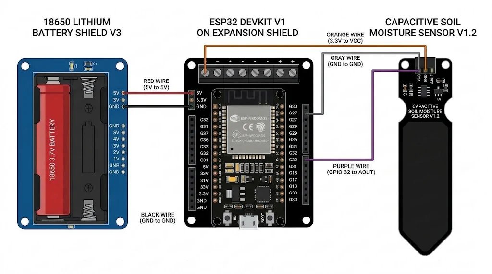

# EcoSensing AI 🌿🛰️

### Urban Microclimate Observatory & Wireless Field Sentinel
**المرصد الجغرافي للمناخ الحضري ومحطة المجس الميداني اللاسلكي**

[](LICENSE)
[](https://www.python.org/)
[](https://fastapi.tiangolo.com/)
[](https://console.groq.com/)
[](https://www.espressif.com/)
[](https://www.openstreetmap.org/)

---

## 🏆 Hackathon & Academic Context

| Field | Details |
|-------|---------|
| **Competition** | EcoTech AI Green Innovation Hackathon |
| **Date** | 16 November 2026 |
| **Institution** | Middle Technical University — Polytechnic College |
| **Department** | Dept. of Electronic & AI Engineering Technologies |
| **Author** | Ali Nihad Qadir (علي نهاد قادر) |
| **License** | MIT |

---

## 📌 Overview

**EcoSensing AI** is a production-grade, full-stack urban environmental intelligence platform combining:

- **Real-time geospatial observation** of Baghdad's atmosphere using open satellite APIs (Open-Meteo, Copernicus CAMS, NASA Landsat UHI/LST).
- **Multi-agent AI pipeline** (3 specialized agents) powered by **Groq LPU** cloud inference — delivering zero-latency, zero-canned-text ecological diagnostics.
- **4D Diurnal Plume physics engine** — a real-time Gaussian dispersion model with temporal wind-shift and urban canyon effects.
- **Wireless ESP32 Soil Sentinel** — capacitive soil moisture measurement with 32-sample trimmed mean filtering, EMA smoothing, and 3-depth virtual moisture gradient, pushing live JSON telemetry over Wi-Fi.
- **Computer Vision Lab** — CLAHE+JET vegetation stress imaging and EXG+VIRIDIS chlorophyll index analysis via Groq Vision API.

> **All geospatial, 4D physics, WHO, and Vision AI features work fully online without any hardware.**  
> The ESP32 is optional and adds real-time field soil moisture telemetry.

---

## 🏗️ System Architecture

```
┌─────────────────────────────────────────────────────────────┐
│                     EcoSensing AI                           │
│                                                             │
│  ┌──────────────┐    ┌────────────────┐    ┌────────────┐  │
│  │  FastAPI     │    │  Multi-Agent   │    │  Static    │  │
│  │  Backend     │◄──►│  AI Pipeline   │    │  Frontend  │  │
│  │  (uvicorn)   │    │  (Groq LPU)    │    │  (vanilla) │  │
│  └──────┬───────┘    └────────────────┘    └────────────┘  │
│         │                                                   │
│  ┌──────▼───────────────────────────────────────────────┐  │
│  │              External Data Sources                   │  │
│  │  Open-Meteo │ Copernicus CAMS │ LocationIQ │ Landsat │  │
│  └──────────────────────────────────────────────────────┘  │
│                                                             │
│  ┌──────────────────────────────────────────────────────┐  │
│  │          ESP32 Soil Sentinel (optional)              │  │
│  │   Capacitive Sensor → GPIO 32 → Wi-Fi Push          │  │
│  │   /api/v1/esp32/push  ←  JSON telemetry             │  │
│  └──────────────────────────────────────────────────────┘  │
└─────────────────────────────────────────────────────────────┘
```

### Data Storage

| Layer | Format | Location |
|-------|--------|----------|
| Experiment logs | UTF-8-SIG `.csv` + multi-sheet `.xlsx` | `reports/experiments/` |
| AI model registry | JSON inventory | `models/` |
| ESP32 calibration | NVS Flash (on-device) | ESP32 non-volatile storage |
| Environment config | `.env` (never committed) | project root |

---

## ✨ Feature Breakdown

### 1. 🛰️ Baghdad Geo-Observatory
Real-time atmospheric and terrain analysis for Baghdad, Iraq:
- **Open-Meteo** — hourly temperature, humidity, wind speed/direction, UV index
- **Copernicus CAMS** — PM2.5, PM10, NO₂, O₃, CO AQI (European AQI standard)
- **UHI / LST** — Urban Heat Island & Land Surface Temperature via NASA Landsat
- **LocationIQ** — reverse geocoding, district lookup, map tile rendering
- **MapLibre GL JS** — interactive satellite + street hybrid basemap

### 2. 🌪️ 4D Diurnal Plume Physics Engine
Physics-based atmospheric dispersion simulation:
- Gaussian plume model with temporal diurnal wind-shift patterns
- Urban canyon channeling and thermal inversion effects
- 4D visualization (longitude × latitude × altitude × time)
- Real-time isopleth rendering on the interactive Baghdad map

### 3. 🤖 Multi-Agent AI Pipeline (Groq LPU)

| Agent | Role | WHO Standard |
|-------|------|-------------|
| **Agent 1** | Soil condition, afforestation suitability, irrigation recommendations | — |
| **Agent 2** | Scientific WHO 2021 benchmark comparison, regional research synthesis | WHO 2021 Air Quality Guidelines |
| **Agent 3** | Vision + Soil Hybrid Lab — CLAHE+JET stress imaging, EXG+VIRIDIS chlorophyll index, source attribution | — |

All agents use **Groq LPU** real-time inference — zero canned responses, zero deterministic fallbacks.

### 4. 📡 Wireless ESP32 Soil Sentinel

- **32-sample Trimmed Mean** — removes 4 outlier samples from each end for clean ADC readings
- **EMA Smoothing** (α = 0.25) — exponential moving average for temporal noise reduction
- **3-depth Virtual Moisture Gradient** — simulates surface (0–10 cm), mid (10–20 cm), root-zone (20–30 cm) VWC profiles
- **Hydrological Regime Classification** — 4 levels: `PERMANENT_WILTING_POINT` / `SUB_OPTIMAL_DEPLETION` / `OPTIMAL_FIELD_CAPACITY` / `WATERLOGGING_HYPOXIA`
- **NVS Flash Calibration** — dry/wet baselines persist across reboots via Serial `CAL_DRY` / `CAL_WET` commands
- **Wi-Fi Push** — JSON telemetry → `/api/v1/esp32/push` every ~700 ms

### 5. 📊 Dynamic ModelEvaluator
- Real-time AI model performance tracking across all three agents
- Cross-agent response latency and confidence scoring
- Experiment logging to UTF-8-SIG CSV + multi-sheet XLSX

---

## 🔌 Hardware Setup

### Components

| Component | Specification |
|-----------|--------------|
| Microcontroller | ESP32 DevKit V1 on Expansion Shield |
| Power | 18650 Lithium Battery Shield V3 |
| Soil Sensor | Capacitive Soil Moisture Sensor V1.2 (Analog) |

### Wiring Diagram



> **Figure 1** — 18650 Battery Shield V3 → ESP32 DevKit V1 → Capacitive Soil Moisture Sensor V1.2

### Pinout Table

| From | Wire | To | Notes |
|------|------|----|-------|
| Battery Shield 5V | 🔴 Red | ESP32 5V | Main power supply |
| Battery Shield GND | ⚫ Black | ESP32 GND | Common ground |
| ESP32 3.3V | 🟠 Orange | Sensor VCC | Use 3.3 V — do not use 5 V |
| ESP32 GND | ⚪ Gray | Sensor GND | Sensor ground reference |
| ESP32 GPIO 32 | 🟣 Purple | Sensor AOUT | Analog signal (ADC1_CH4) |

### Calibration Commands

Open **Arduino IDE → Serial Monitor** at **115200 baud**, then send:

```
CAL_DRY   ← Hold sensor in open air → records dry-air ADC baseline
CAL_WET   ← Submerge sensor tip in clean water → records saturation baseline
```

---

## 🚀 Quick Start

### Prerequisites
- Python 3.11+
- Node.js (optional, for JS linting only)
- Arduino IDE 2.x with ESP32 board package (for firmware flashing)

### 1. Clone & Setup

```bash
git clone https://github.com/YOUR_USERNAME/ecosensing.git
cd ecosensing

# Create and activate virtual environment
python -m venv .venv

# Windows
.venv\Scripts\activate
# Linux / macOS
source .venv/bin/activate

# Install dependencies
pip install -r requirements.txt
```

### 2. Configure Environment

```bash
cp .env.example .env
# Edit .env and fill in your API keys:
#   GROQ_API_KEY     → https://console.groq.com/keys
#   LOCATIONIQ_API_KEY → https://locationiq.com/
```

### 3. Run the Server

```bash
uvicorn app.main:app --host 0.0.0.0 --port 8000 --reload
```

Open `http://localhost:8000` in your browser.

### 4. Flash ESP32 (Optional)

1. Open `firmware/EcoSensing_ESP32_WiFi_Soil_Sentinel.ino` in Arduino IDE.
2. Replace the three placeholders:
   - `YOUR_WIFI_SSID` → your Wi-Fi network name
   - `YOUR_WIFI_PASSWORD` → your Wi-Fi password
   - `YOUR_SERVER_IP` → LAN IP of the machine running uvicorn
3. Select **ESP32 Dev Module** board, upload.
4. Open Serial Monitor @ 115200 baud to see live JSON telemetry.
5. Run `CAL_DRY` and `CAL_WET` calibration commands once.

---

## 📡 API Reference

| Method | Endpoint | Description |
|--------|----------|-------------|
| `GET` | `/` | Dashboard HTML |
| `GET` | `/api/v1/telemetry` | Real-time atmospheric data |
| `GET` | `/api/v1/esp32/status` | ESP32 connection status |
| `POST` | `/api/v1/esp32/push` | ESP32 telemetry ingestion |
| `GET` | `/api/v1/esp32/latest-reading` | Latest sensor reading |
| `POST` | `/api/v1/analyze` | AI multi-agent analysis |
| `POST` | `/api/v1/vision/analyze` | Vision AI lab |
| `GET` | `/api/pollution-sentinel` | CAMS + WHO pollution agent |
| `GET` | `/static/images/esp32_wiring_diagram.jpg` | Hardware wiring diagram |

---

## 📂 Project Structure

```
ecosensing/
├── app/
│   ├── config.py               # Settings (all secrets from os.getenv)
│   ├── main.py                 # FastAPI application factory
│   ├── models/
│   │   └── schemas.py          # Pydantic request/response models
│   ├── routers/
│   │   └── api.py              # All API route handlers
│   └── services/
│       ├── ai_engine.py        # Orchestration entry point
│       ├── groq_service.py     # Groq LPU dual-key failover client
│       ├── weather_geo_service.py  # Open-Meteo + CAMS + LocationIQ
│       ├── physics_engine.py   # 4D Diurnal Plume physics
│       ├── esp32_soil_bridge.py    # ESP32 telemetry bridge
│       ├── laboratory_vision_agent.py  # Vision AI + CLAHE/EXG
│       ├── pollution_agent.py  # Agent 2 WHO 2021
│       ├── pedological_agent.py    # Soil science agent
│       ├── experiment_logger.py    # CSV/XLSX experiment logging
│       └── model_evaluator.py      # Dynamic AI model evaluation
├── firmware/
│   └── EcoSensing_ESP32_WiFi_Soil_Sentinel.ino  # ESP32 firmware
├── static/
│   ├── index.html              # Single-page dashboard
│   ├── css/style.css           # UI styles
│   ├── js/dashboard.js         # Frontend logic
│   └── images/
│       └── esp32_wiring_diagram.jpg
├── reports/
│   └── experiments/            # *.csv and *.xlsx (git-ignored)
├── .env.example                # Environment template (safe to commit)
├── .gitignore
├── requirements.txt
├── LICENSE
└── README.md
```

---

## 🌍 Data Attribution & Academic References

### Open Data Sources

| Source | Usage | License |
|--------|-------|---------|
| [Open-Meteo](https://open-meteo.com/) | Hourly weather forecasts | CC BY 4.0 |
| [Copernicus CAMS](https://atmosphere.copernicus.eu/) | Air quality / AQI data | Copernicus Open Access |
| [NASA Landsat](https://landsat.gsfc.nasa.gov/) | Land Surface Temperature / UHI | NASA Open Data |
| [WHO Air Quality Guidelines 2021](https://www.who.int/publications/i/item/9789240034228) | PM2.5, PM10, NO₂, O₃ thresholds | WHO |
| [LocationIQ](https://locationiq.com/) | Geocoding & map tiles | LocationIQ ToS |
| [OpenStreetMap](https://www.openstreetmap.org/) | Basemap fallback | ODbL |

### Academic References

1. **Al-Dabbas & Al-Khafaji (2020)** — Dust storms and particulate matter over Baghdad.  
   *Iraqi Journal of Science*, 61(8).  
   DOI: [10.24996/ijs.2020.61.8.14](https://doi.org/10.24996/ijs.2020.61.8.14)

2. **Zhou et al. (2019)** — Multi-scale urban heat island detection from satellite imagery.  
   *Remote Sensing*, 11(1), 48.  
   DOI: [10.3390/rs11010048](https://doi.org/10.3390/rs11010048)

3. **Gerhards et al. (2019)** — Challenges and future perspectives of hyperspectral plant disease detection.  
   *Remote Sensing*, 11(10), 1240.  
   DOI: [10.3390/rs11101240](https://doi.org/10.3390/rs11101240)

4. **Neinavaz et al. (2021)** — Effects of prediction accuracy of leaf area index on thermal infrared remote sensing.  
   *International Journal of Applied Earth Observation*, 102, 102415.  
   DOI: [10.1016/j.jag.2021.102415](https://doi.org/10.1016/j.jag.2021.102415)

---

## 🔒 Security

- All API keys are loaded exclusively from `.env` via `os.getenv()` — **zero hardcoded secrets** in source code.
- `.env` is git-ignored. Use `.env.example` as a safe template.
- The LocationIQ map tile key is served via backend proxy — never exposed in client-side JS bundles.
- See [SECURITY.md](SECURITY.md) or open an issue for responsible disclosure.

---

## 📄 License

This project is licensed under the **MIT License** — see [LICENSE](LICENSE) for details.

Copyright (c) 2026 Ali Nihad Qadir (علي نهاد قادر)

---

<div align="center">
  <sub>Built with 💚 for Baghdad's environment — EcoTech AI Green Innovation Hackathon 2026</sub><br/>
  <sub>الجامعة التقنية الوسطى — كلية البوليتكنيك — قسم تقنيات هندسة الإلكترونيك والذكاء الاصطناعي</sub>
</div>
